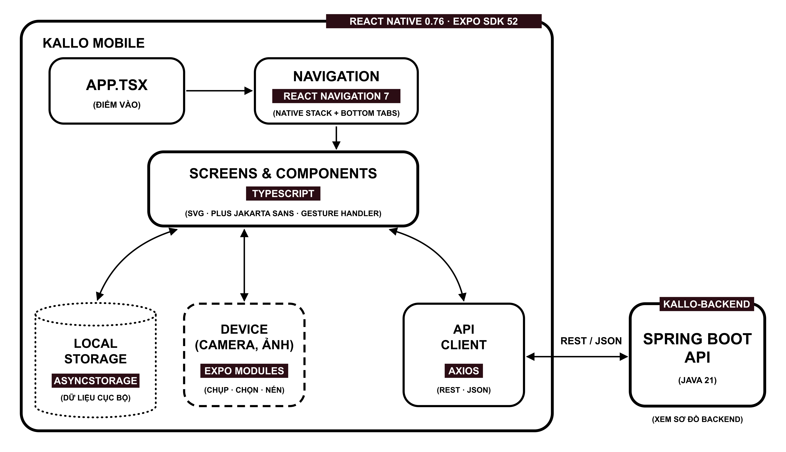

# Kallo – Mobile App

> Ứng dụng di động (React Native / Expo) cho **Kallo** – trợ lý chăm sóc sức khỏe và dinh dưỡng tích hợp AI: theo dõi bữa ăn, cân nặng, vận động; nhận diện món ăn Việt Nam qua ảnh và ước lượng calo.


## Mục lục

- [Giới thiệu](#giới-thiệu)
- [Tính năng chính](#tính-năng-chính)
- [Kiến trúc hệ thống](#kiến-trúc-hệ-thống)
- [Công nghệ sử dụng](#công-nghệ-sử-dụng)
- [Yêu cầu hệ thống](#yêu-cầu-hệ-thống)
- [Cài đặt & chạy dự án](#cài-đặt--chạy-dự-án)
- [Testing](#testing)
- [Tài liệu](#tài-liệu)
- [License](#license)

## Giới thiệu

Kallo đóng vai trò như một trợ lý sức khỏe cá nhân, giúp người dùng theo dõi dinh dưỡng, kiểm soát cân nặng và vận động thể chất một cách tiện lợi, tự động hoá. Hệ thống tích hợp pipeline nhận diện món ăn Việt Nam (YOLO, tập dữ liệu VietFood68) và ước lượng calo, được xây dựng và triển khai độc lập, không phụ thuộc API AI bên thứ ba.

Các thành phần khác của hệ thống:

| Thành phần         | Công nghệ                          | Repository                 |
|--------------------|------------------------------------|----------------------------|
| **Mobile app (repo này)**       | React Native, Expo, TypeScript     |           |
| AI service         | Python, FastAPI, ONNX Runtime      | _(cập nhật link)_          |
| Backend | Java, Spring Boot 4.x          | [kallo-backend](https://github.com/tranductrung04/kallo-backend)                          |

## Tính năng chính

- **Tài khoản & hồ sơ sức khoẻ:** đăng ký/đăng nhập (Email, Google OAuth2), khôi phục mật khẩu, thể trạng – mục tiêu cân nặng – dị ứng; tự tính BMI, TDEE, mục tiêu calo hàng ngày.
- **Dinh dưỡng & bữa ăn:** nhật ký bữa ăn (Sáng/Trưa/Tối/Bữa phụ), nhận diện món ăn qua ảnh, tra cứu món, quét mã vạch, món ăn tuỳ chỉnh.
- **Kế hoạch bữa ăn & trợ lý AI:** gợi ý thực đơn cá nhân hoá theo calo/dị ứng/ngân sách, chatbot tư vấn dinh dưỡng.
- **Vận động & chỉ số cơ thể:** nhật ký tập luyện, đồng bộ Google Fit / Apple Health, lịch sử cân nặng, nước uống.
- **Báo cáo & thống kê:** dashboard, biểu đồ calo/macro/cân nặng theo ngày/tuần/tháng, dự đoán xu hướng cân nặng.
- **Streak & động lực:** chuỗi ngày, thử thách, huy hiệu, kết bạn, bảng xếp hạng thời gian thực (WebSocket).
- **Tiện ích:** thông báo đẩy (FCM), nhắc nhở thông minh, hỗ trợ đồng bộ khi offline.

## Kiến trúc hệ thống



## Công nghệ sử dụng

| Thành phần          | Công nghệ                                                         |
| ------------------- | ----------------------------------------------------------------- |
| Ngôn ngữ            | TypeScript 5.3                                                    |
| Framework           | React Native 0.76, Expo SDK 52                                    |
| UI                  | React 18.3                                                        |
| Điều hướng          | React Navigation 7                    |
| HTTP client         | Axios                                                             |
| Lưu trữ cục bộ      | `@react-native-async-storage/async-storage`                       |
| Camera & ảnh        | `expo-camera`, `expo-image-picker`, `expo-image-manipulator`      |
| Đồ họa vector       | `react-native-svg`                                                |
| Cử chỉ & layout     | `react-native-gesture-handler`, `react-native-screens`, `react-native-safe-area-context` |
| Font                | Plus Jakarta Sans        |
| Tooling             | Babel, TypeScript compiler       |
| Quản lý gói         | npm                                                               |


## Yêu cầu hệ thống

- Node.js 18.0.0 trở lên
- npm (hoặc yarn / pnpm)
- Ứng dụng **Expo Go** trên điện thoại, hoặc trình giả lập Android / iOS
- macOS nếu muốn chạy trình giả lập iOS

## Cài đặt & chạy dự án

### 1. Clone repository

```bash
git clone https://github.com/tranductrung04/kallo-frontend.git
cd kallo-frontend
```

### 2. Cài đặt dependencies

```bash
npm install
```

### 3. Chạy ứng dụng

```bash
npm run start      # mở Expo Dev Server, quét QR bằng Expo Go
npm run android    # chạy trên Android
npm run ios        # chạy trên iOS (cần macOS)
```

## Testing

```bash
npm run typecheck  
npm run self-check
```

## Tài liệu

- [docs](/docs) - yêu cầu chức năng, thiết kế giao diện

## License

MIT. See [LICENSE](LICENSE) file.
